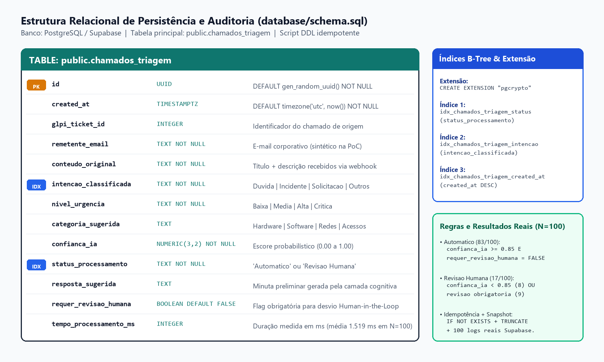
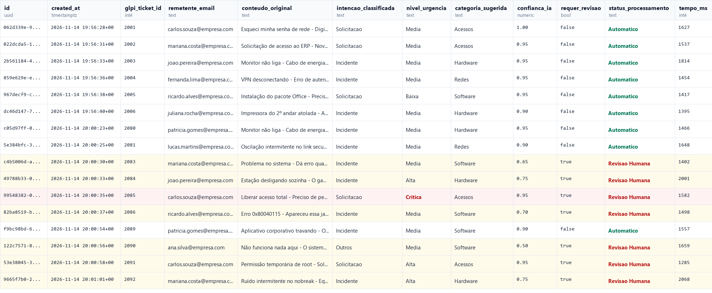

# tcc-hiperautomacao-poc


-2563EB)


Este repositório reúne os artefatos técnicos, conjuntos de dados sintéticos, logs reais de execução exportados do n8n, snapshot do Supabase, script de conferência e diagramas da **Prova de Conceito (PoC)** desenvolvida para o Trabalho de Conclusão de Curso (TCC) em Bacharelado em Sistemas de Informação da Faculdade Multivix Cachoeiro de Itapemirim.

**Título do Trabalho:** Hiperautomação Cognitiva: Governança e Redirecionamento Estratégico do Trabalho Humano  
**Autores:** Caio Lennon Freitas Vandermuren, Felipe Sabino Maraboti, Thales Menini Ferrari  
**Orientador:** Prof. Edgard da Cunha Pontes  

---

## 1. Arquitetura da Solução em Três Camadas
A PoC executa a triagem e o encaminhamento condicional de 100 chamados sintéticos inspirados no atendimento de Nível 1 do GLPI, organizados em três camadas:

1. **Camada 1 — Orquestração Híbrida LCNC (`n8n` v2.47.7):** Fluxo [`n8n-workflows/triagem-chamados-workflow.json`](n8n-workflows/triagem-chamados-workflow.json) (`id: tccPoCTriagemGLPI`) disparado via `Webhook` HTTP `POST` (`/glpi-ticket-webhook`), com histórico completo habilitado (`saveDataSuccessExecution = all`, `saveDataErrorExecution = all`, `saveManualExecutions = true`), nó condicional `Verifica Confianca (Score >= 0.85)` e emulação das requisições de saída ao GLPI por meio de `https://httpbin.org/post`.
2. **Camada 2 — Persistência (`Supabase / PostgreSQL`):** Tabela relacional `chamados_triagem` e três índices B-Tree definidos em [`database/schema.sql`](database/schema.sql), registrando entradas, classificações, escores de confiança, respostas sugeridas, status de roteamento e `tempo_processamento_ms` medido em tempo real (`Date.now() - timestamp_inicio_ms`).
3. **Camada 3 — Processamento Cognitivo (`Google Gemini + LangChain`):** Nó `Google Gemini Chat Model` configurado com identificador `models/gemini-3.5-flash-lite` e `temperature = 0` (`0.0`), acoplado ao `Structured Output Parser` (`fromJson`) e às diretrizes determinísticas de [`prompts/system-prompt-ia.md`](prompts/system-prompt-ia.md).

### Fluxo Operacional da PoC


---

## 2. Estrutura do Repositório

```text
tcc-hiperautomacao-poc/
├── data/
│   ├── chamados_sinteticos_100.json       # Conjunto de entrada com 100 chamados sintéticos
│   └── gabarito_classificacao_100.csv     # Gabarito esperado (categoria, intenção e roteamento)
├── database/
│   ├── README.md                          # Documentação relacional e diagrama da tabela SQL
│   └── schema.sql                         # DDL idempotente + índices B-Tree + snapshot dos 100 registros reais
├── docs/
│   └── imagens/                           # Diagramas BPMN, topologia n8n, Supabase real e DER SQL
├── evidencias/
│   ├── logs_execucao_n8n_100.json         # Logs sanitizados das 100 execuções ao vivo no n8n + Gemini
│   ├── resultados_execucao_100.csv        # Tabela completa dos 100 resultados gravados no Supabase
│   ├── resultados_execucao_100.json       # Espelho detalhado em JSON (Supabase + n8n_execution_id + gabarito)
│   ├── resumo_indicadores.md              # Memória de cálculo, matrizes de confusão e limites
│   └── testes_valor_limite_httpbin.json   # Testes controlados via Python (0.84, 0.85, 0.86, 0.92)
├── n8n-workflows/
│   └── triagem-chamados-workflow.json     # Workflow exportado do n8n (sem credenciais/tokens)
├── prompts/
│   └── system-prompt-ia.md                # System prompt completo, JSON Schema e testes de fronteira
├── scripts/
│   ├── gerar_diagramas_poc.py             # Script gerador das figuras e captura da tabela Supabase
│   └── validar_poc.py                     # Auditoria de paridade (data/ == n8n == Supabase == SQL) + BVA
└── README.md
```

---

## 3. Evidências Reais de Execução e Distinção de Camadas (`N = 100`)

Todas as 100 solicitações sintéticas (`IDs 2001` a `2100`) percorreram integralmente o fluxo no **n8n v2.47.7**, receberam inferência ao vivo do **Google Gemini (`models/gemini-3.5-flash-lite`, `temperature = 0`)**, acionaram a emulação HTTP (`https://httpbin.org/post` — 100/100 retornaram HTTP `200`) e gravaram um registro auditável no **Supabase (`chamados_triagem`)**:

1. **Logs individuais do n8n ([`evidencias/logs_execucao_n8n_100.json`](evidencias/logs_execucao_n8n_100.json)):** contém os 100 rastreamentos nó a nó exportados do banco do n8n (`status = "success"`), incluindo `tokenUsage`, `finishReason = "STOP"`, saída do `Structured Output Parser`, decisão do nó `IF`, corpo ecoado pelo `httpbin.org/post` e UUID retornado pelo Supabase (credenciais e IPs sanitizados).
2. **Registros reais do Supabase ([`evidencias/resultados_execucao_100.json`](evidencias/resultados_execucao_100.json), `.csv` e [`database/schema.sql`](database/schema.sql)):** preservam as 100 linhas efetivamente inseridas no banco pelo nó `Registra Auditoria no Supabase`, incluindo UUID real, timestamp UTC e latência medida (`tempo_processamento_ms`), sem preenchimento artificial (`1900` ms removido).
3. **Testes controlados de fronteira via Python ([`scripts/validar_poc.py`](scripts/validar_poc.py) -> [`evidencias/testes_valor_limite_httpbin.json`](evidencias/testes_valor_limite_httpbin.json)):** como o modelo Gemini em execução real retornou confiança em múltiplos de `0,05` (`0,50` a `1,00`), o script Python executa adicionalmente 5 disparos HTTP `POST` diretos contra `https://httpbin.org/post` sobre os exatos valores de fronteira (`0,84`, `0,85`, `0,86` e crítico `0,92`), devidamente rotulados com `executado_no_n8n = false` e `inferencia_gemini_real = false`.

### Indicadores Reais Medidos (`logs_execucao_n8n_100.json` + Supabase)

| Indicador | Critério / Evidência Real (`N = 100`) | Resultado Obtido |
| :--- | :--- | :--- |
| Conjunto processado no n8n + Gemini | Execuções concluídas com `status = "success"` (`2001..2100`) | **100 de 100 (100,0%)** |
| Cenários padronizados vs. ambíguos/críticos | IDs `2001..2080` e `2081..2100` | **80** padronizados (20/categoria) e **20** ambíguos/críticos |
| Acurácia categorial (padronizados) | `categoria_sugerida == categoria_gabarito` (`2001..2080`) | **80 de 80 (100,0%)** |
| Acurácia de intenção (padronizados) | `intencao_classificada == intencao_gabarito` (`2001..2080`) | **80 de 80 (100,0%)** |
| Acurácia categorial global (`N = 100`) | `categoria_sugerida == categoria_gabarito` (`2001..2100`) | **99 de 100 (99,0%)** *(1 divergência em `2090` com confiança `0,50` -> Revisão Humana)* |
| Concordância de roteamento global | `status_processamento == roteamento_esperado` (`2001..2100`) | **99 de 100 (99,0%)** *(1 divergência em `2089`: `0,90` -> Automático)* |
| Encaminhamento automático | `confianca >= 0.85` e `requer_revisao_humana = false` | **83 de 100 (83,0%)** |
| Encaminhamento para revisão humana (HITL) | `8` baixa confiança (`< 0.85`) + `9` críticos (`>= 0.85` + revisão obrigatória) | **17 de 100 (17,0%)** |
| Tempo total medido (Webhook -> Supabase) | Média / Mediana / Mín.–Máx. (`tempo_processamento_ms`) | **1.519,4 ms (~1,52 s)** / Mediana **1.487,0 ms** (`1.285`–`2.068` ms) |
| Latência isolada do nó Gemini | Média / Mediana / Mín.–Máx. (`Google Gemini Chat Model`) | **937,4 ms** / Mediana **918,0 ms** (`723`–`1.466` ms) |
| Consumo total de tokens (`N = 100`) | `tokenUsage` registrado pelo nó Gemini no n8n | **103.060 tokens** (`88.965` prompt + `14.095` saída; média `1.030,6`/chamado) |

### Casos de Referência, Críticos e Limite (Reais no n8n + Controle Python)

| Ticket ID | Cenário | Execução Real n8n (`Gemini`) | Teste Controlado Python (`httpbin.org`) |
| :---: | :--- | :--- | :--- |
| `2001` | Senha bloqueada AD (padronizado) | `conf = 1.00`, `rev = false` -> `Automatico` (`1.627 ms`) | `conf = 0.95` -> `Automatico` (HTTP 200) |
| `2080` | Monitor não liga (limite superior) | `conf = 0.95`, `rev = false` -> `Automatico` (`1.466 ms`) | `conf = 0.86` -> `Automatico` (HTTP 200) |
| `2081` | Oscilação no link secundário (limiar) | `conf = 0.90`, `rev = false` -> `Automatico` (`1.648 ms`) | `conf = 0.85` -> `Automatico` (HTTP 200) |
| `2084` | Estação desligando sozinha (`< 0.85`) | `conf = 0.75`, `rev = true` -> `Revisao Humana` (`2.001 ms`) | `conf = 0.84` -> `Revisao Humana` (HTTP 200) |
| `2085` | Acesso admin servidor prod (crítico) | `conf = 0.95`, `rev = true` -> `Revisao Humana` (`1.582 ms`) | `conf = 0.92` -> `Revisao Humana` (HTTP 200) |

---

## 4. Diagramas BPMN e Evidências Visuais

### Modelagem BPMN Comparativa (Cenário Hipotético As-Is vs. Cenário To-Be da PoC)
O cenário *As-Is* representa uma referência conceitual hipotética (sem medições empíricas de fila ou tempo em empresa real), enquanto o cenário *To-Be* representa o fluxo da PoC com saída emulada via HTTP para o GLPI e os indicadores medidos na amostra de 100 chamados.

| Cenário Hipotético (As-Is) | Cenário Proposto na PoC (To-Be) |
| :---: | :---: |
|  |  |

### Topologia do Workflow no n8n


### Estrutura Relacional (`database/schema.sql`) e Registros Reais no Supabase
A estrutura DDL completa e o snapshot das 100 execuções estão documentados em [`database/README.md`](database/README.md) e [`database/schema.sql`](database/schema.sql):



Amostra de registros reais gravados pelo fluxo n8n na tabela `chamados_triagem` do Supabase (incluindo `2001..2006`, casos críticos/ambíguos `2083..2092` com `tempo_processamento_ms`):



---

## 5. Passos de Reprodução e Dependências

### Dependências
- **Banco de Dados:** Projeto Supabase ou PostgreSQL 14+ com suporte à extensão `pgcrypto`.
- **Orquestrador:** Instância n8n (`2.x`) com os nós LangChain habilitados (`@n8n/n8n-nodes-langchain`) e acesso externo para `https://httpbin.org/post`, Supabase REST API e API Google Gemini.
- **Auditoria local:** Python 3.10+ (para `scripts/validar_poc.py` — biblioteca padrão) e Pillow (`pip install pillow`) para regenerar figuras em `scripts/gerar_diagramas_poc.py`.

### Como Reproduzir
1. **Banco de Dados (`Supabase / PostgreSQL`):**
   - Abra o SQL Editor do Supabase e execute integralmente [`database/schema.sql`](database/schema.sql).
   - O script cria a tabela `chamados_triagem`, cria os três índices B-Tree e carrega o snapshot dos 100 registros reais produzidos pela execução no n8n.
   - Execute as consultas comentadas ao final de [`database/schema.sql`](database/schema.sql) para conferir `COUNT(*) = 100`, média de `tempo_processamento_ms = 1519.4` e a distribuição `83 Automatico / 17 Revisao Humana`.
2. **Orquestrador (`n8n`):**
   - Importe [`n8n-workflows/triagem-chamados-workflow.json`](n8n-workflows/triagem-chamados-workflow.json) no n8n.
   - Configure suas próprias credenciais nos nós `Google Gemini Chat Model` e `Registra Auditoria no Supabase` (nenhuma chave ou token é armazenado no repositório).
   - Ative o histórico em *Settings* (`Save failed` = All, `Save successful` = All, `Save manual` = On), publique o workflow e envie requisições `POST` para `/glpi-ticket-webhook` usando os 100 chamados de [`data/chamados_sinteticos_100.json`](data/chamados_sinteticos_100.json).
3. **Auditoria Completa de Paridade e Testes de Fronteira:**
   ```bash
   python scripts/validar_poc.py
   ```
   O script verifica configurações e ausência de segredos, valida 100% de paridade entre `data/`, `evidencias/logs_execucao_n8n_100.json`, `evidencias/resultados_execucao_100.*` e `database/schema.sql` (em SQLite em memória), executa os testes de valor-limite contra `https://httpbin.org/post` e atualiza `evidencias/resumo_indicadores.md`.

---

## 6. Limitações e Escopo da Prova de Conceito (PoC)
- **Entrada sintética:** os 100 chamados (`2001..2100`) foram elaborados sinteticamente para viabilizar o experimento de forma controlada, reprodutível e sem exposição de dados pessoais ou corporativos reais.
- **Emulação da saída do GLPI:** os nós de encaminhamento (`Atualiza Chamado no GLPI (API)` e `Desvio para Fila Humana (Human-in-the-Loop)`) comunicam via `HTTP POST` com `https://httpbin.org/post`, comprovando a formatação de payload e recepção HTTP `200`, sem alterar tickets em um servidor GLPI produtivo.
- **Condições da medição de latência:** o tempo médio efetivo de `1.519,4 ms` (~`1,52 s`) refere-se à amostra experimental controlada (`N = 100`) executada com requisições sequenciais e retentativas com *backoff* para 11 limitações transientes (`HTTP 429`) da API gratuita do Gemini, não representando garantia de SLA ou disponibilidade `24×7` em ambiente produtivo.
- **Escoragem do modelo:** o campo `confianca` representa uma estimativa retornada pelo próprio LLM, o que justifica o controle híbrido com revisão humana obrigatória (`requer_revisao_humana = true`) para casos ambíguos ou críticos (`2089` exemplifica a importância de calibragem periódica de regras pelo CoE).
