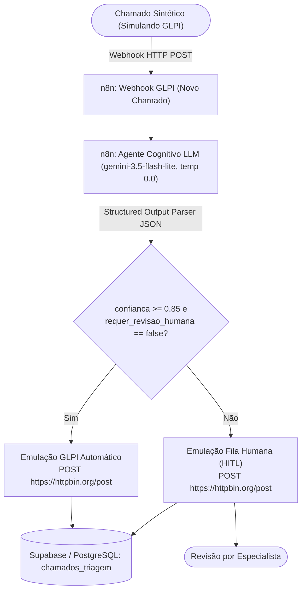
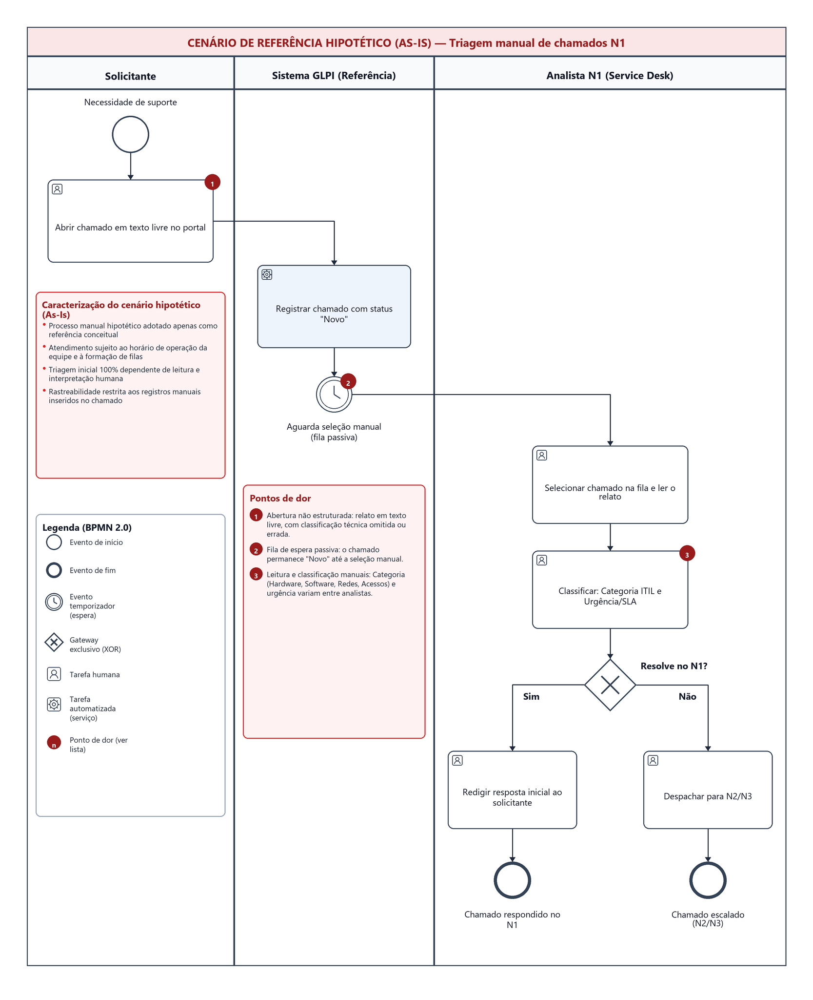
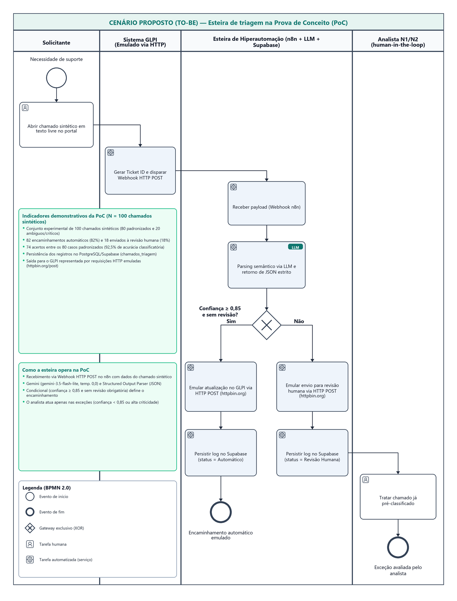
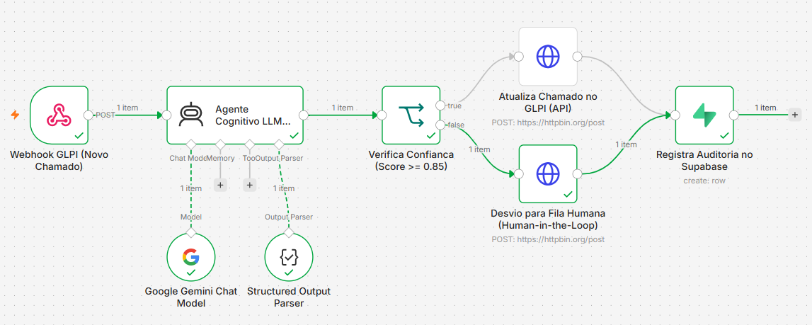

# tcc-hiperautomacao-poc


-2563EB)


Este repositório reúne os artefatos técnicos, conjuntos de dados sintéticos, registros de conferência e diagramas da **Prova de Conceito (PoC)** desenvolvida para o Trabalho de Conclusão de Curso (TCC) em Bacharelado em Sistemas de Informação da Faculdade Multivix Cachoeiro de Itapemirim.

**Título do Trabalho:** Hiperautomação Cognitiva: Governança e Redirecionamento Estratégico do Trabalho Humano  
**Autores:** Caio Lennon Freitas Vandermuren, Felipe Sabino Maraboti, Thales Menini Ferrari  
**Orientador:** Prof. Edgard da Cunha Pontes  

---

## 1. Arquitetura da Solução em Três Camadas
A PoC demonstra a triagem e o encaminhamento condicional de chamados sintéticos inspirados no atendimento de Nível 1 do GLPI, organizados em três camadas:

1. **Camada 1 — Orquestração Híbrida LCNC (`n8n`):** Fluxo [`n8n-workflows/triagem-chamados-workflow.json`](n8n-workflows/triagem-chamados-workflow.json) disparado via `Webhook` HTTP `POST` (`/glpi-ticket-webhook`), com nó condicional `Verifica Confianca (Score >= 0.85)` e emulação das requisições de saída ao GLPI por meio do serviço `https://httpbin.org/post`.
2. **Camada 2 — Persistência (`Supabase / PostgreSQL`):** Tabela relacional `chamados_triagem` e três índices B-Tree definidos em [`database/schema.sql`](database/schema.sql), registrando entradas, classificações, escores de confiança e status de roteamento.
3. **Camada 3 — Processamento Cognitivo (`Google Gemini + LangChain`):** Nó `Google Gemini Chat Model` configurado com identificador `models/gemini-3.5-flash-lite` e `temperature = 0` (`0.0`), acoplado ao `Structured Output Parser` e às diretrizes restritivas de [`prompts/system-prompt-ia.md`](prompts/system-prompt-ia.md).

### Fluxo Operacional da PoC



---

## 2. Estrutura do Repositório

```text
tcc-hiperautomacao-poc/
├── data/
│   ├── chamados_sinteticos_100.json       # Conjunto de entrada com 100 chamados sintéticos
│   └── gabarito_classificacao_100.csv     # Gabarito esperado (categoria, intenção e roteamento)
├── database/
│   ├── README.md                          # Documentação relacional e diagrama da tabela SQL
│   └── schema.sql                         # DDL idempotente + índices B-Tree + snapshot sintético (N=100)
├── docs/
│   └── imagens/                           # Diagramas BPMN atualizados, n8n, Supabase e DER SQL
├── evidencias/
│   ├── resultados_execucao_100.csv        # Tabela completa dos 100 resultados conferíveis
│   ├── resultados_execucao_100.json       # Registros detalhados em JSON
│   ├── resumo_indicadores.md              # Memória de cálculo, matriz de confusão e limites
│   └── testes_valor_limite_httpbin.json   # Logs reais de POST em https://httpbin.org/post
├── n8n-workflows/
│   └── triagem-chamados-workflow.json     # Workflow exportado do n8n (sem credenciais/tokens)
├── prompts/
│   └── system-prompt-ia.md                # System prompt, JSON Schema e testes de valor-limite
├── scripts/
│   ├── gerar_diagramas_poc.py             # Script gerador das figuras e captura da tabela
│   └── validar_poc.py                     # Script reprodutível de validação e testes httpbin.org
└── README.md
```

---

## 3. Comprovação dos Indicadores e Distinção das Evidências (`N = 100`)

Para manter total rigor e transparência acadêmica, este repositório distingue explicitamente:
- **Dados sintéticos criados por SQL ([`database/schema.sql`](database/schema.sql)):** o bloco `INSERT ... FROM generate_series(1, 100)` gera de forma determinística e reproduzível os **100 registros sintéticos** usados como referência para os indicadores descritos no artigo. Ele **não** representa 100 chamadas pagas ao vivo em ambiente produtivo.
- **Configuração da inferência no n8n ([`n8n-workflows/triagem-chamados-workflow.json`](n8n-workflows/triagem-chamados-workflow.json) e [`prompts/system-prompt-ia.md`](prompts/system-prompt-ia.md)):** define o modelo `models/gemini-3.5-flash-lite`, temperatura `0.0`, `Structured Output Parser` e regra de corte (`confianca >= 0.85` e `requer_revisao_humana == false`).
- **Comunicação HTTP emulada executada ([`evidencias/testes_valor_limite_httpbin.json`](evidencias/testes_valor_limite_httpbin.json)):** validação executada via requisições reais `HTTP POST` contra `https://httpbin.org/post` (o mesmo endpoint configurado nos nós HTTP do n8n), comprovando o roteamento dos limites `0,84`, `0,85`, `0,86` e do caso crítico com confiança alta (`0,92`).

### Indicadores Conferidos em [`evidencias/resumo_indicadores.md`](evidencias/resumo_indicadores.md)

| Indicador | Critério / Fonte | Valor Conferido |
| :--- | :--- | :--- |
| Conjunto de chamados sintéticos | `data/chamados_sinteticos_100.json` | **100** (25 Hardware, 25 Software, 25 Redes, 25 Acessos) |
| Cenários padronizados vs. ambíguos/críticos | IDs `2001..2080` e `2081..2100` | **80** padronizados (20/categoria) e **20** ambíguos/críticos |
| Acurácia categorial (cenários padronizados) | `categoria_sugerida == categoria_gabarito` | **74 de 80 (92,5%)** — 6 divergências limítrofes |
| Encaminhamento automático | `confianca >= 0.85` e `requer_revisao_humana = false` | **82 de 100 (82,0%)** |
| Encaminhamento para revisão humana | `confianca < 0.85` ou `requer_revisao_humana = true` | **18 de 100 (18,0%)** |

### Validação dos Testes de Valor-Limite (*Boundary Value Analysis*)

| Ticket ID | Cenário | Confiança | `requer_revisao_humana` | Ramo Executado | Emulação `httpbin.org/post` |
| :---: | :--- | :---: | :---: | :--- | :---: |
| `2080` | Caso A — Acima do limiar (`> 0.85`) | `0.86` | `false` | `Automatico` | HTTP 200 |
| `2081` | Caso B — No limiar exato (`= 0.85`) | `0.85` | `false` | `Automatico` | HTTP 200 |
| `2084` | Caso C — Abaixo do limiar (`< 0.85`) | `0.84` | `true` | `Revisao Humana` | HTTP 200 |
| `2085` | Caso D — Crítico com confiança alta (`>= 0.85` + risco) | `0.92` | `true` | `Revisao Humana` | HTTP 200 |

---

## 4. Diagramas BPMN e Evidências Visuais

### Modelagem BPMN Comparativa (Cenário Hipotético As-Is vs. Cenário To-Be da PoC)
O cenário *As-Is* representa uma referência conceitual hipotética (sem medições empíricas de fila ou tempo em empresa real), enquanto o cenário *To-Be* representa exclusivamente o fluxo da PoC com saída emulada via HTTP para o GLPI.

| Cenário Hipotético (As-Is) | Cenário Proposto na PoC (To-Be) |
| :---: | :---: |
|  |  |

### Topologia do Workflow no n8n


### Estrutura Relacional (`database/schema.sql`) e Registros no Supabase
A estrutura DDL completa está documentada em [`database/README.md`](database/README.md) e [`database/schema.sql`](database/schema.sql):


Amostra de registros consistentes na tabela `chamados_triagem` (incluindo os casos de limite `2080`, `2081`, `2084` e o caso crítico `2085`):


---

## 5. Passos de Reprodução e Dependências

### Dependências
- **Banco de Dados:** Projeto Supabase ou PostgreSQL 14+ com suporte à extensão `pgcrypto`.
- **Orquestrador:** Instância n8n (Cloud ou Self-Hosted) com os pacotes LangChain habilitados (`@n8n/n8n-nodes-langchain`) e acesso à rede externa para `https://httpbin.org/post` e à API Google Gemini.
- **Validação local (opcional):** Python 3.10+ (para `scripts/validar_poc.py` — usa apenas biblioteca padrão) e Pillow (`pip install pillow`) caso deseje regenerar as imagens via `scripts/gerar_diagramas_poc.py`.

### Como Reproduzir
1. **Banco de Dados (`Supabase / PostgreSQL`):**
   - Abra o SQL Editor do Supabase e execute integralmente [`database/schema.sql`](database/schema.sql).
   - O script cria a tabela `chamados_triagem`, cria os três índices B-Tree e carrega os 100 registros sintéticos de referência.
   - Execute as consultas comentadas ao final de [`database/schema.sql`](database/schema.sql) para conferir `COUNT(*) = 100`, a distribuição `82 / 18` e os casos de fronteira (`2080`, `2081`, `2084`, `2085`).
2. **Orquestrador (`n8n`):**
   - Importe [`n8n-workflows/triagem-chamados-workflow.json`](n8n-workflows/triagem-chamados-workflow.json) no n8n.
   - Configure suas próprias credenciais nos nós `Google Gemini Chat Model` e `Registra Auditoria no Supabase` (nenhum token ou senha é armazenado no repositório).
   - Envie requisições `POST` para o endpoint `/glpi-ticket-webhook` usando payloads de [`data/chamados_sinteticos_100.json`](data/chamados_sinteticos_100.json) ou [`prompts/system-prompt-ia.md`](prompts/system-prompt-ia.md).
3. **Conferência Local dos Indicadores e Emulação HTTP:**
   ```bash
   python scripts/validar_poc.py
   ```
   O script valida as configurações do workflow, regenera/confere os datasets e indicadores em `data/` e `evidencias/`, e executa as requisições de teste para `https://httpbin.org/post`.

---

## 6. Limitações da Prova de Conceito (PoC)
- **Dados exclusivamente sintéticos:** os 100 chamados não provêm de atendimentos reais de usuários nem contemplam ruído linguístico corporativo completo.
- **Emulação de saída do GLPI:** a integração com o GLPI foi emulada por meio de requisições `HTTP POST` para `https://httpbin.org/post`, sem alterar tickets em uma instância GLPI produtiva.
- **Ausência de medição de SLA ou redução de tempo em produção:** valores de `tempo_processamento_ms` no snapshot SQL são sintéticos; não há comprovação empírica de redução de tempo em fila real, disponibilidade 24×7 ou impacto direto sobre trabalhadores.
- **Escoragem subjetiva do modelo:** o campo `confianca` representa uma estimativa heurística retornada pelo próprio LLM, exigindo revisão contínua pelo Centro de Excelência (CoE) e supervisão humana para casos ambíguos ou críticos.
