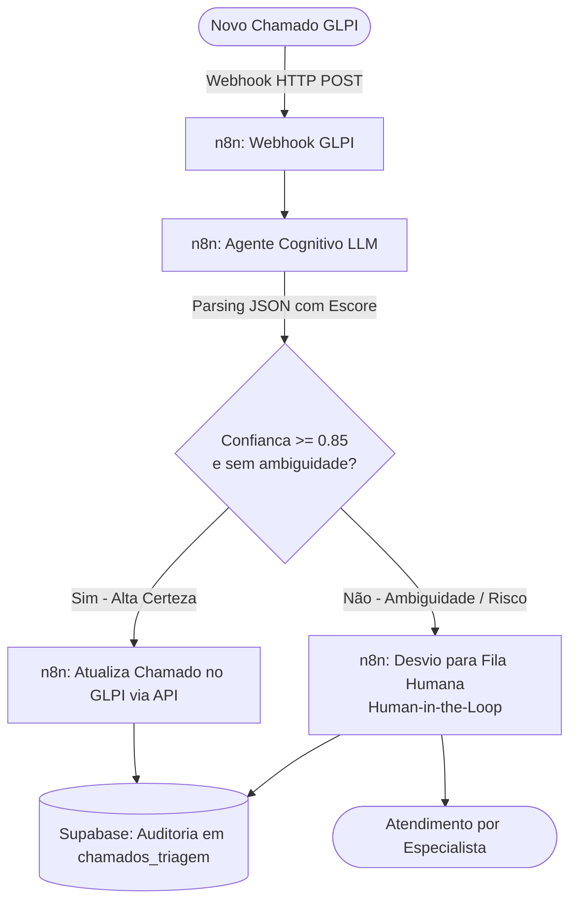

# tcc-hiperautomacao-poc


Este repositório contém a Prova de Conceito (*Proof of Concept* - PoC) da esteira de hiperautomação experimental desenvolvida para o Trabalho de Conclusão de Curso (TCC) em Bacharelado em Sistemas de Informação da Faculdade Multivix Cachoeiro de Itapemirim.

**Título do Trabalho:** Hiperautomação Cognitiva: Governança e Redirecionamento Estratégico do Trabalho Humano  
**Autores:** Caio Lennon Freitas Vandermuren, Felipe Sabino Maraboti, Thales Menini Ferrari  
**Orientador:** Prof. Edgard da Cunha Pontes  

---

## 1. Arquitetura da Solução em Três Camadas
A esteira automatiza a triagem, classificação categorial e roteamento de chamados abertos em linguagem natural no sistema GLPI:
1. **Camada 1 (Orquestração Híbrida LCNC):** Fluxo no n8n disparado via Webhook HTTP POST pelo GLPI com roteamento condicional (gateway XOR) e convergência de logs.
2. **Camada 2 (Persistência e Auditoria):** Banco relacional PostgreSQL gerenciado no Supabase para governança e rastreabilidade integral de 100% das transações (tabela `chamados_triagem`).
3. **Camada 3 (Cognição Semântica):** Agente LLM baseado no modelo Google Gemini (`gemini-3.5-flash-lite`, `temperature = 0.0`) acoplado ao *Structured Output Parser* no módulo LangChain do n8n.

### Fluxo Operacional da PoC



---

## 2. Estrutura do Repositório
```text
tcc-hiperautomacao-poc/
├── n8n-workflows/
│   └── triagem-chamados-workflow.json  # Fluxo convergente exportado do n8n
├── database/
│   └── schema.sql                      # DDL da tabela, índices B-Tree e Seed (N = 100)
├── prompts/
│   └── system-prompt-ia.md             # System Prompt, JSON Schema e Dataset de Análise de Valor-Limite
└── README.md                           # Documentação técnica e guia de reprodução
```

- [`n8n-workflows/triagem-chamados-workflow.json`](n8n-workflows/triagem-chamados-workflow.json): Fluxo convergente exportado do n8n.
- [`database/schema.sql`](database/schema.sql): DDL da tabela, índices B-Tree e Seed (`N = 100`).
- [`prompts/system-prompt-ia.md`](prompts/system-prompt-ia.md): System Prompt, JSON Schema e Dataset de Análise de Valor-Limite.

---

## 3. Metodologia Experimental e Resultados (N = 100)

A validação experimental utilizou uma amostra controlada de **N = 100 chamados sintéticos anonimizados** (25 de Hardware, 25 de Software, 25 de Redes e 25 de Acessos; divididos em 80 cenários padronizados e 20 cenários ambíguos/críticos), aplicando a **técnica de Análise de Valor-Limite (*Boundary Value Analysis*)** sobre o limiar de confiança (`0.85`), onde os valores limítrofes (0,84, 0,85 e 0,86) foram validados diretamente no gateway condicional (nó IF) do n8n via injeção de payloads simulados. Para o isolamento das métricas de orquestração e cognição, os endpoints REST do GLPI foram emulados via `httpbin.org/post`.

- **Caso de Teste (`confianca >= 0.85`):** Roteamento autônomo via API do GLPI (`status_processamento = 'Automatico'`).
- **Caso de Teste (`confianca < 0.85` ou alta criticidade):** Desvio *Human-in-the-Loop* para revisão técnica (`status_processamento = 'Revisao Humana'`).

**Indicadores Obtidos:**
- **Retenção Autônoma:** 82% dos chamados (82/100) resolvidos sem toque humano.
- **Supervisão Humana (*Human-in-the-Loop*):** 18% dos chamados (18/100) encaminhados com pré-classificação.
- **Tempo Médio de Processamento:** 1,9 segundo (`~1900 ms`), frente a 3–5 minutos no fluxo manual.
- **Acurácia Classificatória:** 92,5% nos cenários padronizados e 100% de rastreabilidade em SQL.

---

## 4. Instruções de Implantação
1. **Banco de Dados (Supabase / PostgreSQL):**
   - Execute o script [`database/schema.sql`](database/schema.sql) no SQL Editor do Supabase para criar a tabela `chamados_triagem`, os índices de auditoria e popular a amostra experimental de 100 chamados.
2. **Orquestrador (n8n):**
   - Importe o arquivo [`n8n-workflows/triagem-chamados-workflow.json`](n8n-workflows/triagem-chamados-workflow.json) na sua instância do n8n.
   - Configure as credenciais da API Google Gemini e do projeto Supabase nas variáveis de ambiente.
3. **Execução de Testes:**
   - Utilize os payloads anonimizados documentados em [`prompts/system-prompt-ia.md`](prompts/system-prompt-ia.md) via requisição POST para o endpoint `/glpi-ticket-webhook`.
