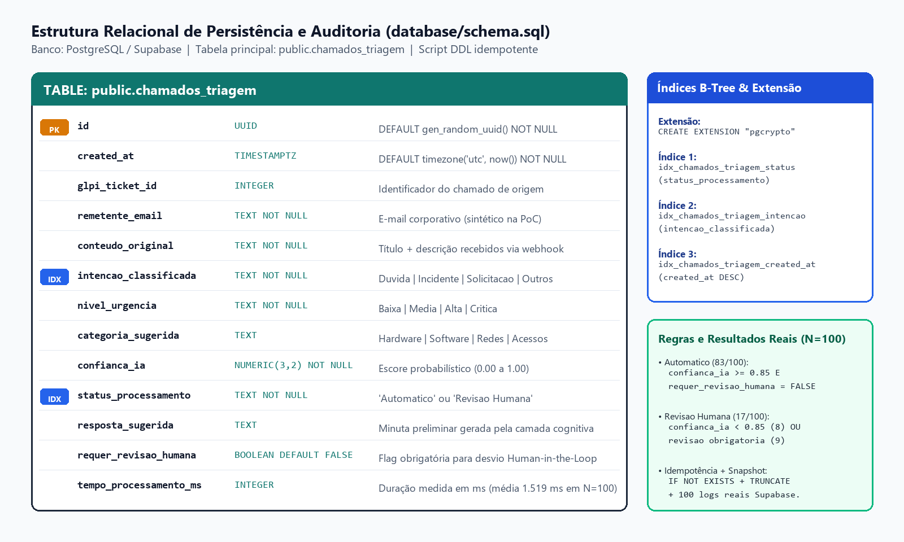

# Camada de Persistência — Supabase / PostgreSQL (`database/schema.sql`)

Este diretório documenta a estrutura relacional e o snapshot real dos 100 registros gravados na tabela `chamados_triagem` pela execução ao vivo da Prova de Conceito (PoC) no n8n + Google Gemini.

## Diagrama da Tabela Relacional e Índices B-Tree

## Resumo do Esquema (`schema.sql`)
- **Extensão:** `pgcrypto` (habilita `gen_random_uuid()` para chaves primárias UUID).
- **Tabela:** `public.chamados_triagem` (13 colunas cobrindo UUID, timestamps UTC, metadados do chamado, entrada textual, saída estruturada da camada cognitiva, decisão de roteamento, minuto/resposta sugerida e `tempo_processamento_ms` medido em tempo real).
- **Índices B-Tree:**
  - `idx_chamados_triagem_status` em `(status_processamento)`
  - `idx_chamados_triagem_intencao` em `(intencao_classificada)`
  - `idx_chamados_triagem_created_at` em `(created_at DESC)`
- **Idempotência:** O DDL utiliza `CREATE EXTENSION IF NOT EXISTS`, `CREATE TABLE IF NOT EXISTS`, `CREATE INDEX IF NOT EXISTS` e `TRUNCATE TABLE` antes do `INSERT ... VALUES`, podendo ser reexecutado sem erros no SQL Editor do Supabase ou em qualquer instância PostgreSQL compatível.

## Origem dos 100 Registros em `database/schema.sql`
- O bloco `INSERT INTO chamados_triagem (...) VALUES ...` reproduz fielmente os **100 registros reais gravados no Supabase** pelo nó `Registra Auditoria no Supabase` durante a execução em lote no **n8n v2.47.7** (`workflow_id = tccPoCTriagemGLPI`) com o modelo **`models/gemini-3.5-flash-lite`** (`temperature = 0`), preservando os UUIDs reais, timestamps UTC, respostas sugeridas geradas pelo LLM e `tempo_processamento_ms` efetivamente medido (`média = 1.519,4 ms`).
- Os logs completos de cada uma das 100 execuções individuais (entrada do Webhook, consumo de tokens do Gemini, JSON do parser, nó IF e resposta HTTP 200 da emulação via `https://httpbin.org/post`) estão publicados em [`../evidencias/logs_execucao_n8n_100.json`](../evidencias/logs_execucao_n8n_100.json).
- Os textos de entrada (`data/chamados_sinteticos_100.json`) permanecem sintéticos/anonimizados e a saída para o GLPI permanece emulada via `https://httpbin.org/post` (sem alteração em instância GLPI produtiva).
