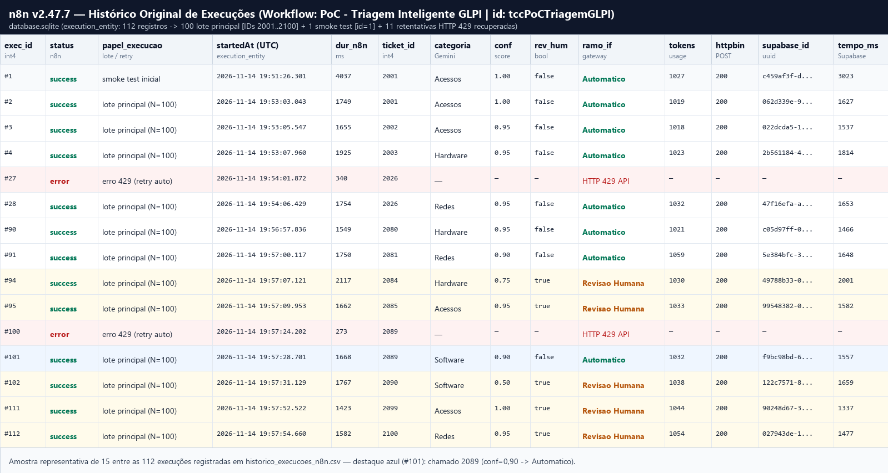

# Resumo de Conferência e Recálculo Direto dos Indicadores da PoC

## 1. Origem das Evidências e Separação de Camadas (`N = 100`)
Todos os 100 chamados sintéticos foram executados ao vivo pelo fluxo no **n8n v2.47.7** (`workflow_id = tccPoCTriagemGLPI`), processados individualmente pelo modelo **Google Gemini (`models/gemini-3.5-flash-lite`, `temperature = 0`)** com **Structured Output Parser**, encaminhados via **`https://httpbin.org/post`** (emulando saída GLPI / fila humana sem instância produtiva) e persistidos no **Supabase (`chamados_triagem`)**:

1. **Entrada e Gabarito Sintético ([`../data/chamados_sinteticos_100.json`](../data/chamados_sinteticos_100.json), [`../data/gabarito_classificacao_100.csv`](../data/gabarito_classificacao_100.csv)):** 100 chamados fictícios anonimizados (25 Hardware, 25 Software, 25 Redes e 25 Acessos; 80 padronizados `2001..2080` e 20 ambíguos/críticos `2081..2100`).
2. **Logs Individuais das 100 Execuções no n8n ([`logs_execucao_n8n_100.json`](logs_execucao_n8n_100.json)):** rastreamento completo nó a nó de cada uma das 100 execuções (`n8n_execution_id` com `status = "success"`), comprovando entrada do Webhook, latência e consumo de tokens do `Google Gemini Chat Model`, JSON estruturado do `Structured Output Parser`, ramo do nó `IF`, eco HTTP 200 de `https://httpbin.org/post` e UUID gravado no Supabase.
3. **Histórico Original Completo de Execuções do n8n ([`historico_execucoes_n8n.csv`](historico_execucoes_n8n.csv), [`historico_execucoes_n8n.json`](historico_execucoes_n8n.json) e [`../docs/imagens/figura4_historico_execucoes_n8n.png`](../docs/imagens/figura4_historico_execucoes_n8n.png)):** registro cronológico das **112 execuções** originais gravadas pelo n8n em `database.sqlite` (`execution_entity` + `execution_data`), permitindo conferir IDs (`1..112`), horários UTC (`startedAt`/`stoppedAt`), saídas do Gemini, retentativas automáticas para `HTTP 429` (`11` tentativas transientes antes do lote fechar `100/100`) e UUIDs do Supabase.
4. **Registros Reais Persistidos no Supabase ([`resultados_execucao_100.json`](resultados_execucao_100.json), [`resultados_execucao_100.csv`](resultados_execucao_100.csv) e [`../database/schema.sql`](../database/schema.sql)):** espelho exato das 100 linhas gravadas no banco Supabase pelo nó `Registra Auditoria no Supabase`, preservando UUIDs, timestamps UTC, respostas sugeridas geradas pelo LLM, sinalizadores individuais de acerto (`acerto_categoria`, `acerto_intencao`, `acerto_roteamento`) e `tempo_processamento_ms` medido em tempo real.
5. **Testes Controlados de Valor-Limite via Python ([`testes_valor_limite_httpbin.json`](testes_valor_limite_httpbin.json)):** requisições `HTTP POST` disparadas diretamente por [`../scripts/validar_poc.py`](../scripts/validar_poc.py) para `https://httpbin.org/post` avaliando exatamente os escores de fronteira `0.84`, `0.85`, `0.86` e `0.92` (`executado_no_n8n = false`, `inferencia_gemini_real = false`), complementando as execuções ao vivo do Gemini (que retornou escores em múltiplos de `0.05`: `0.50`, `0.65`, `0.70`, `0.75`, `0.80`, `0.90`, `0.95`, `1.00`).

### 1.1 Rastreabilidade do Histórico Original no n8n (`112` Registros em `execution_entity`)
- **`#1` (`smoke_test_inicial`):** validação inicial do webhook com chamado `2001` (`status = success`, `19:51:26.301 UTC`), anterior à limpeza do banco para início do lote experimental.
- **`100` execuções `lote_principal_100_chamados` (`#2` a `#112`):** janela contínua de `2026-11-14 19:53:03.043` a `19:57:56.242 UTC`, com correspondência 1-para-1 comprovada nos IDs, timestamps, saídas do Gemini, respostas `HTTP 200` do `httpbin.org` e gravações no Supabase.
- **`11` registros `tentativa_transiente_retry_429` (`status = error`):** falhas pontuais de cota momentânea (`HTTP 429 Too Many Requests` na API gratuita do Gemini nos IDs `#27`, `#29`, `#31`, `#34`, `#51`, `#53`, `#54`, `#77`, `#78`, `#97` e `#100`), imediatamente reenviadas e concluídas com sucesso na execução subsequente.

---

## 2. Configuração Técnica Conferida
- **Orquestrador:** n8n `v2.47.7` | Workflow ID `tccPoCTriagemGLPI` (8 nós)
- **Histórico de execuções habilitado:** `saveDataSuccessExecution = "all"`, `saveDataErrorExecution = "all"`, `saveManualExecutions = true`
- **Modelo LLM:** `models/gemini-3.5-flash-lite` | Temperatura: `0`
- **Parser JSON:** `@n8n/n8n-nodes-langchain.outputParserStructured`
- **Limiar do gateway IF:** `confianca >= 0.85` AND `requer_revisao_humana == false`
- **Expressão `tempo_processamento_ms`:** `={{ $('Webhook GLPI (Novo Chamado)').item.json.body.timestamp_inicio_ms ? Math.max(1, Date.now() - Number($('Webhook GLPI (Novo Chamado)').item.json.body.timestamp_inicio_ms)) : ($json.tempo_processamento_ms ?? null) }}` (medição real em ms sem fallback artificial)
- **Endpoints HTTP emulados:** `https://httpbin.org/post` (automático e revisão humana; 100/100 retornaram HTTP 200)
- **Varredura de segredos/tokens:** Limpa (`secret_scan_clean = True`)

---

## 3. Indicadores Recalculados Diretamente dos Logs do n8n (`N = 100`)
Todos os números abaixo foram recalculados diretamente pelo script [`../scripts/validar_poc.py`](../scripts/validar_poc.py) a partir dos `node_traces` individuais de [`logs_execucao_n8n_100.json`](logs_execucao_n8n_100.json) e conferidos com 100% de paridade contra `resultados_execucao_100.json`, `resultados_execucao_100.csv` e `database/schema.sql`:

| Indicador | Critério / Fórmula Direta sobre `logs_execucao_n8n_100.json` | Resultado Recalculado |
| :--- | :--- | :--- |
| Chamados sintéticos processados | Execuções `status = success` no n8n e linhas no Supabase | **100 de 100 (100,0%)** |
| Acurácia categorial (padronizados) | `categoria_glpi == categoria_gabarito` em `2001..2080` | **80 de 80 (100.0%)** |
| Acurácia de intenção (padronizados) | `intencao == intencao_gabarito` em `2001..2080` | **80 de 80 (100.0%)** |
| Acurácia categorial global (`N = 100`) | `categoria_glpi == categoria_gabarito` em `2001..2100` | **99 de 100 (99.0%)** |
| Acurácia de intenção global (`N = 100`) | `intencao == intencao_gabarito` em `2001..2100` | **99 de 100 (99.0%)** |
| Concordância de roteamento global | Ramo executado no nó `IF` == `roteamento_esperado` em `2001..2100` | **99 de 100 (99.0%)** |
| Encaminhamento automático | Ramo `branch_taken = true` (`confianca >= 0.85` e `requer_revisao_humana = false`) | **83 de 100 (83.0%)** |
| Encaminhamento para revisão humana | Ramo `branch_taken = false` (`8` com confiança `< 0.85` + `9` críticos `>= 0.85`) | **17 de 100 (17.0%)** |
| Soma e média de `tempo_processamento_ms` | Soma = `151,938 ms` / Média = `151938/100` | **1519.38 ms (1519.4 ms / ~1.52 s)** |
| Mediana, desvio padrão e amplitude | Valores reais de `tempo_processamento_ms` no nó Supabase | Mediana **1487.0 ms** / DP **163.65 ms** / **1285** (ID `2091`)–**2068 ms** (ID `2092`) |
| Latência isolada do nó Gemini Chat Model | `executionTime_ms` acumulado = `93,737 ms` | **937.37 ms** / Mediana **918.0 ms** (723–1466 ms) |
| Consumo total de tokens (`N = 100`) | Soma direta de `tokenUsage` (`promptTokens + completionTokens`) | **103,060** tokens (88,965 prompt + 14,095 saída; média **1030.6**/chamado) |
| Retentativas transientes (`HTTP 429`) | Contagem registrada na coleta da API gratuita do Gemini | **11** retentativas transientes (100% concluídos com sucesso) |

### 3.1 Decomposição da Latência por Nó do Fluxo (`node_traces`)

| Nó do Workflow (`n8n`) | Função na Esteira | Execuções | Média | Mediana | Mín.–Máx. |
| :--- | :--- | :---: | :---: | :---: | :---: |
| `Webhook GLPI (Novo Chamado)` | Recepção HTTP POST | 100 | 0.30 ms | 0.0 ms | 0–1 ms |
| `Google Gemini Chat Model` | Inferência LLM (`models/gemini-3.5-flash-lite`) | 100 | 937.37 ms | 918.0 ms | 723–1466 ms |
| `Structured Output Parser` | Validação JSON Schema | 100 | 0.56 ms | 1.0 ms | 0–2 ms |
| `Agente Cognitivo LLM (Parsing)` | Nó agente composto (Gemini + Parser) | 100 | 957.87 ms | 939.5 ms | 741–1485 ms |
| `Verifica Confianca (Score >= 0.85)` | Gateway condicional (`IF`) | 100 | 3.28 ms | 3.0 ms | 1–6 ms |
| `Atualiza Chamado no GLPI (API)` | Ramo Automático -> `httpbin.org/post` | 83 | 453.73 ms | 435.0 ms | 406–1142 ms |
| `Desvio para Fila Humana (Human-in-the-Loop)` | Ramo HITL -> `httpbin.org/post` | 17 | 480.88 ms | 433.0 ms | 417–1152 ms |
| `Registra Auditoria no Supabase` | Persistência REST PostgreSQL | 100 | 162.02 ms | 154.5 ms | 124–383 ms |
| **Total ponta a ponta medido (`tempo_processamento_ms`)** | `Date.now() - timestamp_inicio_ms` gravado no Supabase | **100** | **1519.38 ms** | **1487.0 ms** | **1285–2068 ms** |

---

## 4. Matrizes de Confusão Reais (`Google Gemini` vs. Gabarito)

### 4.1 Subconjunto Padronizado (`2001..2080`, `N = 80`) — 80/80 (100.0%)

| Gabarito \ Predição Gemini | Hardware | Software | Redes | Acessos | Total Gabarito |
| :--- | :---: | :---: | :---: | :---: | :---: |
| **Hardware** | 20 | 0 | 0 | 0 | 20 |
| **Software** | 0 | 20 | 0 | 0 | 20 |
| **Redes** | 0 | 0 | 20 | 0 | 20 |
| **Acessos** | 0 | 0 | 0 | 20 | 20 |

### 4.2 Amostra Completa (`2001..2100`, `N = 100`) — 99/100 (99.0%)

| Gabarito \ Predição Gemini | Hardware | Software | Redes | Acessos | Total Gabarito |
| :--- | :---: | :---: | :---: | :---: | :---: |
| **Hardware** | 24 | 1 | 0 | 0 | 25 |
| **Software** | 0 | 25 | 0 | 0 | 25 |
| **Redes** | 0 | 0 | 25 | 0 | 25 |
| **Acessos** | 0 | 0 | 0 | 25 | 25 |

### 4.3 Divergências Observadas no Subconjunto Ambíguo/Crítico (`N = 100`)

| Ticket ID | Execução n8n | Conteúdo | Gabarito (Cat / Int / Rot) | Gemini Real (Cat / Int / Rot) | Confiança |
| :---: | :---: | :--- | :---: | :---: | :---: |
| 2083 | 93 | Problema no sistema - Dá erro quando tento salvar, mas às vezes vai. Verificar. | Software / Duvida / Revisao Humana | Software / Incidente / Revisao Humana | 0.65 |
| 2089 | 101 | Aplicativo corporativo travando - O sistema financeiro fecha sozinho ao gerar relatório sem exibir código de erro. | Software / Incidente / Revisao Humana | Software / Incidente / Automatico | 0.90 |
| 2090 | 102 | Não funciona nada aqui - O sistema parou depois que mexeram ontem, não sei se é rede ou PC. | Hardware / Outros / Revisao Humana | Software / Outros / Revisao Humana | 0.50 |

> **Análise das divergências:** Nos casos `2083` e `2090`, apesar da diferença pontual de intenção (`2083`) ou categoria (`2090`) em relatos propositalmente vagos, o modelo atribuiu confiança baixa (`0,65` e `0,50`) e sinalizou `requer_revisao_humana = true`, garantindo o desvio seguro para **Revisão Humana**. Já o chamado `2089` explicita uma exceção crítica para a governança do modelo.

### 4.4 Análise Específica do Chamado `2089` e Implicações para a Governança da PoC
- **Execução no n8n:** `n8n_execution_id = 101` (`2026-11-14 19:57:28.701` a `19:57:30.369 UTC`), UUID Supabase `f9bc98bd-67aa-4555-9343-56870c1e935a`, duração medida `1.557 ms`.
- **Entrada (`Ambiguo_Critico`):** *"Aplicativo corporativo travando - O sistema financeiro fecha sozinho ao gerar relatório sem exibir código de erro."*
- **Decisão esperada no gabarito vs. obtida:** O gabarito previa `Revisao Humana` (razão pela qual a expectativa inicial de roteamento era `82/18`). O Gemini acertou `categoria_glpi = "Software"` e `intencao = "Incidente"`, porém atribuiu `urgencia = "Media"`, `confianca = 0.90` e `requer_revisao_humana = false`, fazendo o gateway `IF` (`confianca >= 0.85 && requer_revisao_humana == false`) direcioná-lo para `Automatico` e deslocando o total do lote para **`83` automáticos e `17` revisões humanas**.
- **Causa técnica verificada no prompt ([`../prompts/system-prompt-ia.md`](../prompts/system-prompt-ia.md)):** Como o relato indicou inequivocamente tratar-se de falha em aplicativo (`Software` / `Incidente`), não houve ambiguidade entre componentes (hardware/rede/software). Simultaneamente, a expressão *"sistema financeiro"* não figurava literalmente entre os exemplos de criticidade financeira listados no *System Prompt* (que mencionavam *"integração fiscal/faturamento"*, critério que desviou o chamado `2097` com `confianca = 0.75`), e o LLM não interpretou a ausência de código de erro como critério suficiente para ativar `requer_revisao_humana = true`.
- **Implicação de governança:** O caso comprova que (i) a confiança numérica gerada pelo próprio LLM é uma estimativa probabilística sujeita a excesso de confiança (*overconfidence*) e (ii) restrições de negócio críticas não devem depender apenas de instruções em linguagem natural no prompt, exigindo regras determinísticas complementares no orquestrador (ex.: listas explícitas de palavras-chave críticas e auditoria periódica dos falsos positivos de automação pelo Centro de Excelência).

---

## 5. Casos de Referência, Limite e Críticos Reais no n8n + Supabase

| Ticket ID | `n8n_exec_id` | Categoria Gemini | Confiança | `requer_revisao_humana` | Status Supabase | Tempo Medido | UUID Supabase |
| :---: | :---: | :---: | :---: | :---: | :--- | :---: | :--- |
| 2001 | 2 | Acessos | 1.00 | `false` | Automatico | 1627 ms | `062d339e...` |
| 2080 | 90 | Hardware | 0.95 | `false` | Automatico | 1466 ms | `c05d97ff...` |
| 2081 | 91 | Redes | 0.90 | `false` | Automatico | 1648 ms | `5e384bfc...` |
| 2084 | 94 | Hardware | 0.75 | `true` | Revisao Humana | 2001 ms | `49788b33...` |
| 2085 | 95 | Acessos | 0.95 | `true` | Revisao Humana | 1582 ms | `99548382...` |
| 2090 | 102 | Software | 0.50 | `true` | Revisao Humana | 1659 ms | `122c7571...` |
| 2091 | 103 | Acessos | 0.95 | `true` | Revisao Humana | 1285 ms | `53e38045...` |
| 2092 | 104 | Hardware | 0.75 | `true` | Revisao Humana | 2068 ms | `9665f7b0...` |

---

## 6. Testes Controlados de Valor-Limite HTTP via Python (`scripts/validar_poc.py` -> `httpbin.org/post`)
*Nota: Requisições `HTTP POST` executadas diretamente pelo script Python sobre os exatos escores de fronteira (`0.84`, `0.85`, `0.86`, `0.92`) para testar a precisão matemática do gateway (`executado_no_n8n = false`, `inferencia_gemini_real = false`), em complemento às execuções reais do n8n listadas na Seção 5.*

| Ticket ID | Cenário de Teste | Confiança | `requer_revisao_humana` | Decisão Gateway | Resposta HTTP Emulada (Python) |
| :---: | :--- | :---: | :---: | :---: | :---: |
| 2001 | Cenário padronizado N1 (referência) | 0.95 | `false` | Automatico | HTTP 200 (1115.58 ms) |
| 2080 | Caso A — Acima do limiar (confianca = 0.86) | 0.86 | `false` | Automatico | HTTP 200 (457.43 ms) |
| 2081 | Caso B — No limiar exato (confianca = 0.85) | 0.85 | `false` | Automatico | HTTP 200 (404.97 ms) |
| 2084 | Caso C — Abaixo do limiar (confianca = 0.84) | 0.84 | `true` | Revisao Humana | HTTP 200 (420.17 ms) |
| 2085 | Caso D — Crítico com confiança alta (0.92 + revisão obrigatória) | 0.92 | `true` | Revisao Humana | HTTP 200 (407.26 ms) |
